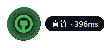

# GitHub 直连悬浮监测器

一个单文件、零依赖的 Windows 桌面悬浮小工具：实时监测当前网络能否直连 GitHub，绿光晕 / 红光晕一眼可见。为中国大陆网络环境（运营商 DNS 解析波动、部分 GitHub 边缘 IP 被阻断）设计。

## 界面预览

鼠标移入徽章查看状态，右键唤出菜单：


| 常驻徽章 | 悬停气泡 | 右键菜单 |
| :---: | :---: | :---: |
|  |  |  |
| 绿光晕 = 可直连<br>红光晕 = 无法直连 | 显示当前延迟<br>或失败原因 | 立即检测 / 退出 |

## 适合谁用

- **中国大陆的开发者 / 学生**：想随时知道当前网络能否**裸连** GitHub——clone、pull 前心里有数；代理该不该开、什么时候可以省着开，看一眼徽章就有答案
- **喜欢轻量常驻小工具的人**：单文件、零第三方依赖、无弹窗无通知，只有一个 68×68 的圆形徽章，不抢注意力
- **想找一份可读的网络检测参考实现的人**：纯标准库实现多源 DoH 并行解析、社区 hosts 源拉取、并发 TCP/TLS 探测，全部代码集中在一个文件里

## 不适合谁

- Linux / macOS 用户（光晕和透明效果依赖 Win32 窗口特性，暂无跨平台计划）
- 想**监测经代理后**的 GitHub 可用性——本工具刻意禁用代理，测的是裸网络直连状态；浏览器插件级代理（如 SwitchyOmega）它感知不到
- 需要自动改 hosts、clone 加速等功能的——这是「监测」工具，不是「加速」工具；相关需求推荐 [GitHub520](https://github.com/521xueweihan/GitHub520)

## 特性

- **圆形徽章悬浮桌面**：始终置顶、半透明、可拖动，仅 68×68，几乎不占地方
  - 绿光晕 = 可直连；红光晕呼吸闪烁 = 无法直连
- **悬停弹出气泡**：显示当前延迟或失败原因（超时 / DNS 失败 / 连接重置…），气泡宽度按文字实际渲染宽度自适应，任何缩放比例下都不会溢出
- **右键菜单**：立即检测 / 退出，与徽章同风格的深色圆角弹窗
- **智能检测链路**，尽力对齐浏览器的真实可用性（见下文）
- 纯 Python 标准库，**无任何第三方依赖**；代码集中在一个文件里，读得懂、改得动

## 运行

| 方式 | 说明 |
| --- | --- |
| Release 下载 | 直接双击 [github-monitor.exe](https://github.com/ClaireMoonlit/github-monitor/releases/latest/download/github-monitor.exe)（无需安装 Python） |
| 源码运行 | 安装 Python 3.8+ 后双击 `github_monitor.pyw`（无控制台窗口），或命令行 `python github_monitor.pyw` |

**开机自启**：`Win + R` 输入 `shell:startup`，把本程序的快捷方式放进去即可。

## 检测策略

每 5 秒按以下顺序检测，任一环节成功即判定为「可访问」：

1. **纯直连**：显式禁用一切代理发起 HTTPS 请求，代表「裸网络直连 GitHub」的真实状态
2. **多源 IP 探测**：直连失败时，并发汇总以下 IP 来源后并发探测（TLS SNI / 证书仍按 `github.com` 域名校验，取最先可达者）：
   - 多家公共 DoH 并行解析：阿里、腾讯 doh.pub、Cloudflare `1.1.1.1` / `cloudflare-dns.com`（不可达的源自动跳过）
   - [GitHub520](https://github.com/521xueweihan/GitHub520) 社区维护的 hosts 源（经 jsDelivr 分发，国内可达）
   - 本地缓存的上次成功 IP（加快后续判定）
   - 内置 GitHub 官方 A 记录候选池（所有 DNS 解析值均出于此，作为最后保底）
3. **系统代理**：仍失败且系统配置了代理时，走系统代理再测一次，气泡会注明当前经「直连」还是「系统代理」

> 为什么要做第 2 步？国内网络下，系统 DNS 可能恰好解析到被阻断的边缘 IP，而浏览器（尤其开了安全 DNS 的）会拿到其他可达 IP——只测一次直连会出现「浏览器打得开、工具却报红」的误报。多源并发探测与任意一家安全 DNS 的行为对齐。

## 已知限制

- 仅支持 Windows（圆角与光晕依赖 Win32 窗口透明色键）
- 无法感知**浏览器插件级代理**（如 SwitchyOmega），这类代理不写入系统设置；「直连」始终代表裸网络状态
- 检测间隔与超时为内置常量，暂未做配置化

## 构建 exe

```bash
pip install pyinstaller
pyinstaller --onefile --noconsole --name github-monitor github_monitor.pyw
```

产物在 `dist/github-monitor.exe`。

## License

[MIT](LICENSE)
